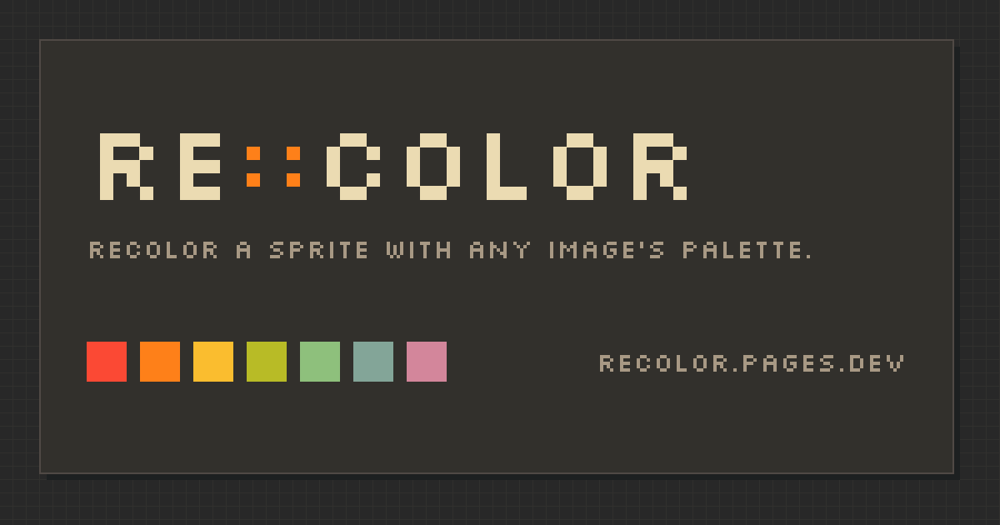

<div align="center">

<h1>re::color</h1>



Recolor a pixel art sprite with any image's palette, privately, in your browser.

[](https://github.com/SirCesarium/re-color/actions/workflows/ci.yml)
[](LICENSE)
[](https://svelte.dev/)
[](https://bun.sh/)
[](#privacy)

</div>

## See it in action

<!-- Video placeholder -->

## Features

### Any image is a palette

Extract a color palette from a reference sprite and __re-colorize__ another one. re::color pulls up to **64 colors** (configurable from 1 to 256) out of the reference image and uses them to repaint your sprite.

### Three ways to map colors

- **Nearest color** — direct RGB nearest-neighbor.
- **Luminance order** — sorts both sprite and palette by brightness and pairs them, so shading survives the swap.
- **Dominant color** — finds your sprite's most-used color and pins it to the palette's dominant, then fills in the rest.

<!-- Image -->

### Pixel-level control

Tap any pixel in the live preview to exclude it from the recolor.

<!-- Image -->

### Download the result

Export the recolored sprite as a PNG — same dimensions as your input, named `<name>-recolored.png`.

### Your session survives a reload

The current palette, sprite, mapping mode and pixel exclusions are saved locally (IndexedDB), so a refresh doesn't lose your work. You can turn this off in settings.

### Preferences that stick

Auto-apply the result, maximum palette colors, default mapping mode, animations and help hints — all in [/settings](https://recolor.pages.dev/settings). Export your preferences as a JSON file and import them on another device, or reset everything to defaults with one click.

### Available in English and Spanish

The interface follows your browser language on first visit, and you can switch anytime in settings.

### Install it as an app

re::color is a PWA: install it from your browser and it runs standalone and offline.

## Limits

| Constraint     | Value     |
| -------------- | --------- |
| Format         | PNG       |
| Max dimensions | 512 × 512 |
| Max file size  | 2 MiB     |

> [!NOTE]
> Currently, this project is designed for small pixel art, such as 8x8px or 16x16px or even 32x32px. For larger images, you might experience some issues with the tool for excluding pixels from recoloring. Improvements to the UX in this area are planned for the near future.

## Privacy

No uploads. No accounts. No analytics. Every pixel is processed on-device, and the app works offline after the first load.

Review the [license](./LICENSE) or the [privacy section](https://recolor.pages.dev/privacy).

## Under the hood

- **Web Worker** — PNG decoding and palette counting run off the main thread, so the UI stays responsive.
- **Service worker** — the whole app is precached: it works offline after the first load, and updates install themselves in the background.
- **Security headers** — `nosniff`, `no-referrer` and `X-Frame-Options: DENY` on every response.

## For devs

### Checks

The CI runs these three commands on every push and pull request — run them before opening one:

```bash
bun run check   # svelte-check
bun test
bun run build
```

### Running with Docker

1. Build the image.

```bash
docker build -t re-color .
```

2. Run the image.

```bash
docker run -d -p 8080:80 --name re-color-app re-color
```

### Opening in Visual Studio Code

- Make sure you have the [Dev Containers](https://marketplace.visualstudio.com/items?itemName=ms-vscode-remote.remote-containers) extension installed.
  1. Open the command palette by pressing `F1` or `Ctrl+Shift+P` (`Cmd+Shift+P` on macOS).
  2. Type and select **`Dev Containers: Reopen in Container`**. This will build the container and bring up all the required development tools automatically.

- If you don't want to use the [Dev Containers](https://marketplace.visualstudio.com/items?itemName=ms-vscode-remote.remote-containers) extension you'll need to install [bun](https://bun.sh/), and then:
  1. Run: `bun install --frozen-lockfile`.
  2. Run: `bun run dev`.

## License

[MIT © SirCesarium](./LICENSE)
